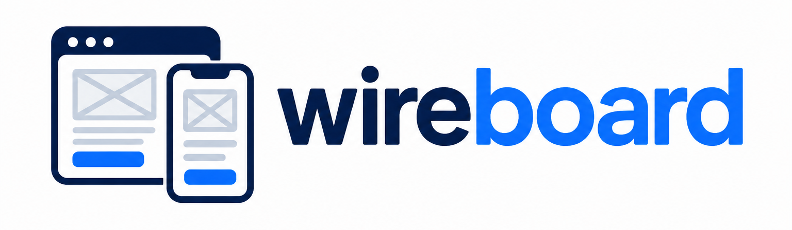
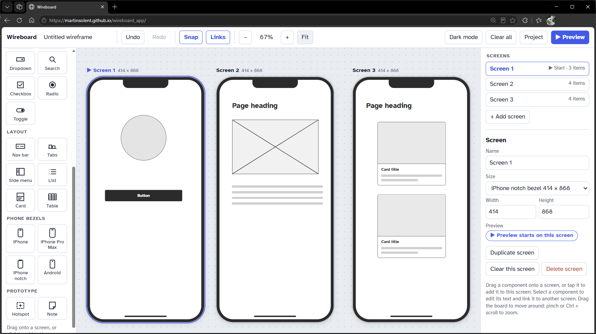

# Wireboard

**Wireboard** is a browser-based tool for creating wireframes and linking screens into clickable prototypes. It runs from a single HTML file and requires no build step or package installation.

## Features

- Create desktop, tablet, and phone-sized screens.
- Build layouts from components for text, buttons, forms, navigation, lists, cards, tables, phone bezels, and more.
- Move, resize, duplicate, lock, and edit components on a pannable, zoomable board.
- Connect screens with links and hotspots, then preview the flow as a prototype.
- Undo and redo changes, snap components to a grid, and switch between light and dark themes.
- Save work automatically in the current browser.
- Export and import project data as JSON, create a standalone HTML prototype, and export screens as PNG images.
- Start with the included example project or create a blank project.

## Getting started

1. Open `index.html` in a modern web browser.
2. Add components from the palette on the left. Drag them onto a screen, or click to add one to the selected screen.
3. Select a component to edit its properties. Add screens and set links in the properties panel.
4. Choose **Preview** to try the clickable prototype, or open **Project** to save, export, or import your work.

No build tools or dependencies are required. You can also serve the project with any static web server and open its `index.html` URL.

## Saving and sharing

Wireboard saves the current project in the browser's local storage as you work. This is specific to the browser and device, so use **Project → Download project file** or **Copy project data** to keep a portable backup. Use the corresponding open options to import a project later.

To share a prototype without the editor, use **Copy prototype HTML** or **Download prototype page**. Use **Selected screen as PNG** or **All screens as PNGs** to export screen images.

## Browser notes

Use a modern browser with JavaScript enabled. The app uses the Atkinson Hyperlegible font from Google Fonts when available and falls back to system fonts. If browser storage is unavailable or cleared, locally saved project data may not persist; export a project file for a separate backup.
